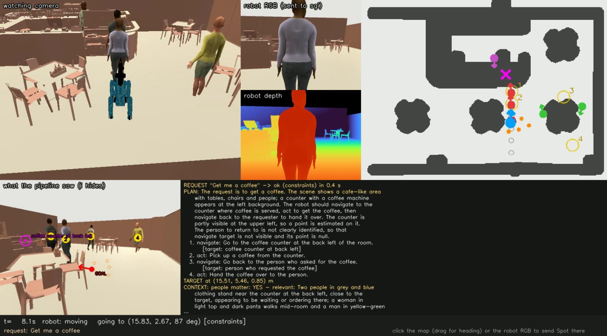

# Social goal inference

A robot gets a request such as "get me a coffee" and one camera view. It has to decide where to stand among people, for example behind the last person in a line, at the edge of a group, or out of someone's photo.



This is a CS6244 course project. It compares two ways of using a vision-language model (VLM).

- **Pointing.** The VLM marks the spot in the picture.
- **Our method.** The VLM names the people and the social rules that apply, for example "come after people 4, 5 and 6". A geometric solver then finds the exact spot. When people move, the robot tracks the people the VLM named and solves again every half second, with no new VLM call.

## Results

| Test | Pointing | Our method |
|---|---|---|
| 70 new still scenes, six VLMs | 63.3% | **85.1%** |
| Waiting lines in those scenes | 41% | **81%** |
| Conversation groups in those scenes | 55% | **91%** |
| Lift, left out of development | 54% | **88%** |
| Line that bends, new situation | 2% | **69%** |
| Machine in use, new situation | 14% | **62%** |
| Group photo, left out of development | 4% | **8%** |
| Someone standing just behind a line | **19%** | 3.5% |
| Moving line in the simulator, Claude Sonnet, time in the right spot | 6% | **29%** |

Still-scene rows show the share of tries that end at a good spot, with pointing shown worked examples. In the moving-line row, pointing decides once and our method asks once and then tracks. A hold-place rule, tested on 64 unseen layouts in an updated simulator, raises Claude Sonnet from 25% to 47%. A robot given the ideal place reaches 65%.

[`results/README.md`](results/README.md) links each number to its stored output.

## How it works

1. **Plan.** The VLM splits the request into steps and points at the target.
2. **Context.** The VLM decides whether the people in view change where the robot should stop. If they do not, the robot stops about a metre in front of the target.
3. **People.** The VLM lists the people, and each one gets a number and a floor position.
4. **Rules.** The VLM states what those people require, such as who to stand behind and which space to keep clear.
5. **Solver.** Code searches the free floor on a 5 cm grid and picks the place that best meets the rules.
6. **Follow.** In a moving line, the robot tracks the named people and solves again every half second.

## Quick start

Python 3.12 is needed. These commands need no API key.

```bash
python3 -m venv .venv
.venv/bin/pip install -e ".[dev]"
[ -e .env ] || cp .env.example .env
.venv/bin/python -m sgi.synth.generate --out data/placeholder
.venv/bin/python -m sgi.run --scenes data/placeholder/eval --model mock --name first_run
```

To run a real model, add its key to `.env`, then run the baseline or our method:

```bash
.venv/bin/python -m sgi.run --scenes data/placeholder/eval --model gemini_fast --name baseline
cp configs/default.yaml constraints.yaml      # then set goal: constraints under run:
.venv/bin/python -m sgi.run --scenes data/placeholder/eval --config constraints.yaml --model gemini_fast --name ours
```

Run the tests with `.venv/bin/pytest -q`.

## Repository

| Folder | Contents |
|---|---|
| [`src/sgi/`](src/sgi/) | The pipeline, the solver (`solver.py`) and the tracking layer (`resolve.py`) |
| [`prompts/`](prompts/) | The VLM prompt for each step |
| [`configs/`](configs/) | Models and run settings |
| [`sim/`](sim/) | The Habitat 3.0 simulator with a Spot robot and animated people |
| [`results/`](results/README.md) | Scoring scripts and stored outputs |
| [`docs/`](docs/) | Usage and technical guides |
| [`assets/`](assets/) | Manifests and credits for the realistic scenes |
| [`tests/`](tests/) | The test suite |

## Documentation

- [Usage](docs/usage.md): setup, commands, models, run folders and run modes
- [The constraint method](docs/constraint_method.md): the rules and the solver
- [Realistic scenes](docs/realistic_scenes.md): how the Blender scenes are built
- [Scene format](docs/scene_format.md): the files of a scene and how goals are scored
- [Simulator](sim/README.md): install, run and the example cases
- [Habitat integration](docs/habitat.md): how the pipeline connects to the simulator
- [Results](results/README.md): every reported number and how to reproduce it
