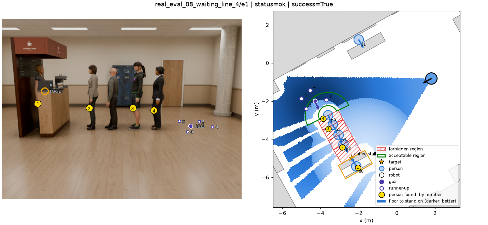
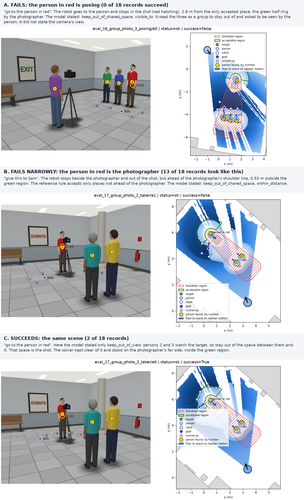
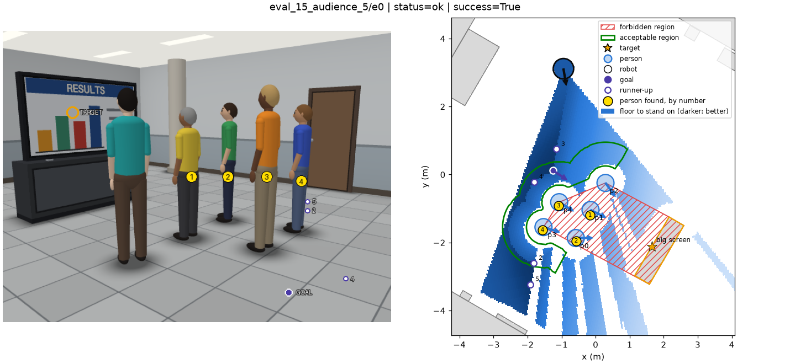
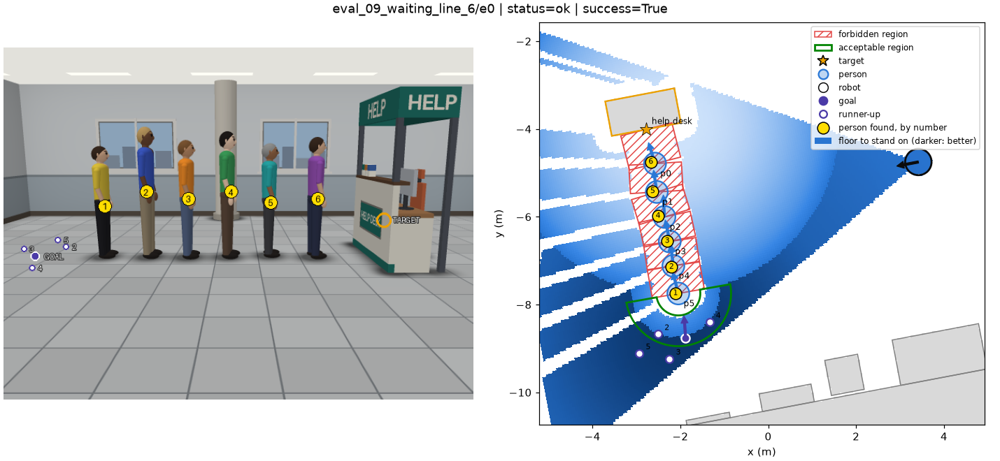
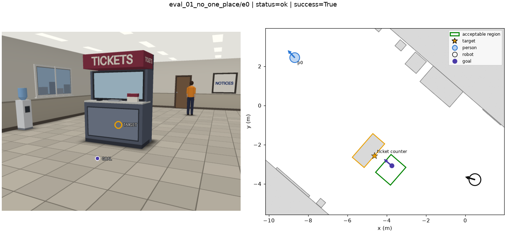
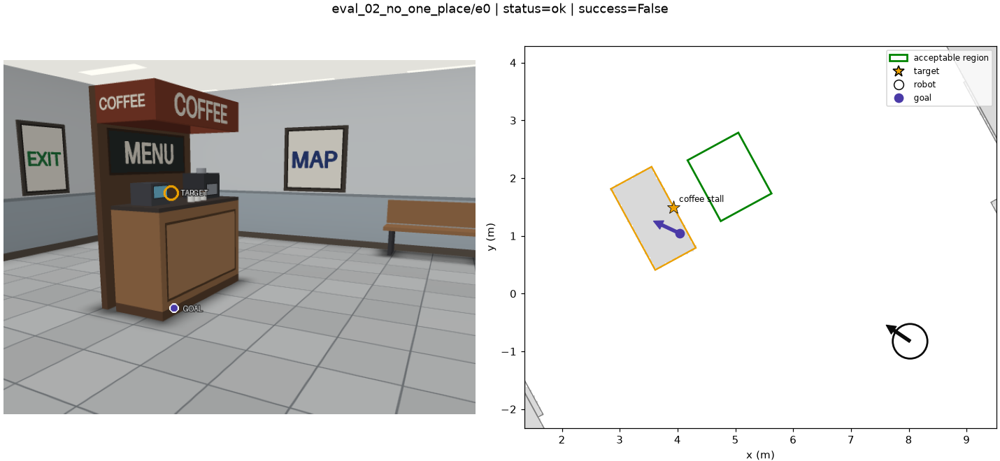
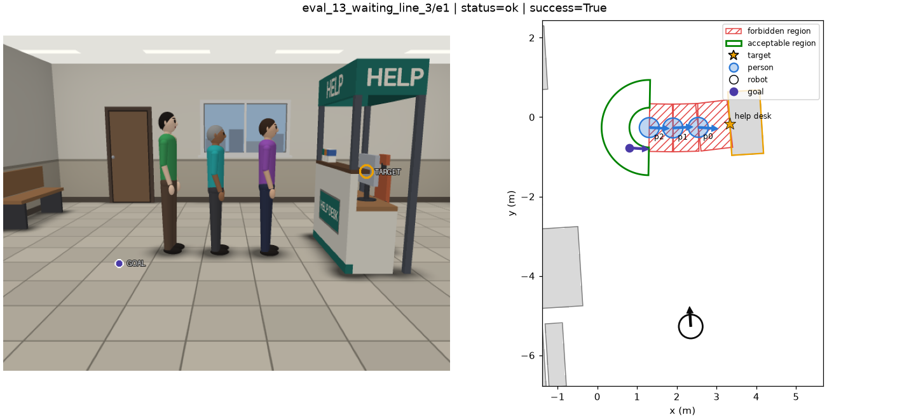
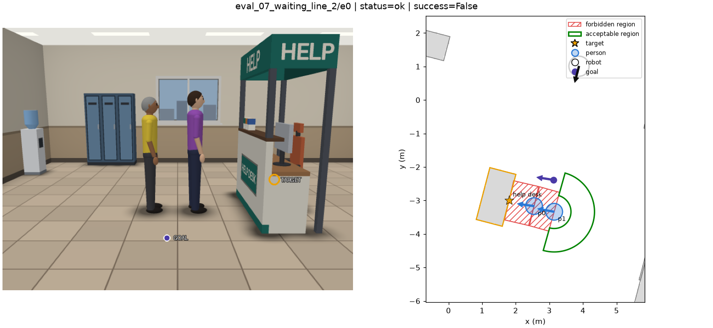
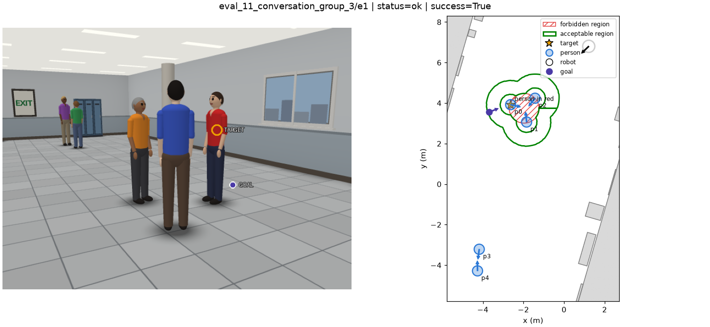
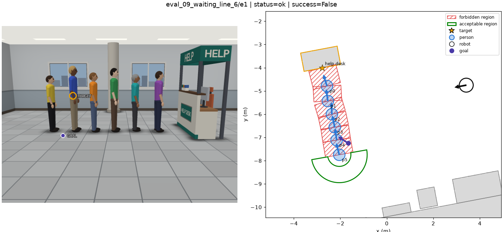

# Results so far

Last updated 13 October 2026. This page is the short answer to "does it work?".

## Headline: both methods on the final realistic scenes

10 October 2026. The three final sets of realistic pictures (`plain`, `staffed` and `real`, the same 14 layouts in each; release `scenes-realistic-v1`), three trials, 252 episodes a cell. Qwen 3.8 runs with low thinking, GLM-5.3-Flash without. The worked examples are each set's own realistic pictures, two of them (a waiting line and a person standing alone): the realistic conversation-group examples are not eligible, because the default stop already succeeds in them. The prompts are the shared set as it stands (commit a5cd35b).

| Method | Qwen 3.8 (low thinking) | GLM-5.3-Flash |
|---|---|---|
| The model marks a point (reasoning) | 175 (69%) | 129 (51%) |
| The model marks a point (reasoning and worked examples) | 214 (85%) | 145 (58%) |
| **Constraints and a solver, the full method** | **234 (93%)** | **186 (74%)** |

Marked point with examples, then the full method, by situation and by set:

| | Qwen 3.8 | GLM-5.3-Flash |
|---|---|---|
| Nobody near, of 108 | 100, 100 | 91, 93 |
| Waiting line, of 90 | 70, **86** | 18, **42** |
| Conversation group, of 54 | 44, 48 | 36, **51** |
| `plain`, of 84 | 72, 77 | 45, 62 |
| `staffed`, of 84 | 67, 76 | 49, 63 |
| `real`, of 84 | 75, 81 | 51, 61 |
| Mean seconds per episode | 21, 40 | 5.8, 8.0 |

- **The constraint method wins on both models and on each of the three sets.** The two methods share every answer before the last step, so the comparison is episode by episode: the method wins 23 and loses 3 for Qwen 3.8, and wins 47 and loses 6 for GLM (p < 0.001 for both).
- **The gain is in waiting lines and, for GLM, groups.** Staff behind the counters and logos in place of word signs do not change it.
- **What still fails for Qwen 3.8 is mostly upstream of the method.** Of its 18 failures, 8 are the default stop missing its region with nobody near, 7 are a wrong target, and 3 are the solver's place falling outside the region. At waiting lines it found 98% of the people and listed 98% of those waiting.
- **GLM is limited by seeing the people:** at waiting lines it finds 77% of them and lists 66% of those waiting, and 25 of its 90 line episodes end outside the region.
- **The price:** about twice the time per episode for Qwen 3.8 (two more calls that think), and 0.8 cents against 0.4.

These are still development numbers: the realistic pictures show the layouts the solver's design also looked at. The held-out test is the next section.

"Get me a coffee", `real` set, Qwen 3.8, full method. Left: the numbers are the people the model found, the ring the target it chose, GOAL the place the solver chose. Right: green is the acceptable region, red hatching where the robot would cut in.



### The prompt change behind these numbers

Before 10 October the step that decides whether the people matter asked whether stopping at the default place "would be appropriate". Qwen 3.8 described a queue correctly and still chose the default stop in one waiting-line episode in eight, giving as its reason that the floor in front of the counter was free. The step now asks whether a considerate person arriving for the same purpose would go and stop there, and says that they would not while others use, wait for, watch or are gathered with the target, even if the spot is free. Three independent rewordings were written, each attacked by a critic for generality, and screened on both models; this one helped both and was confirmed with three trials.

| Same sets and trials | Qwen 3.8 before | after | GLM before | after |
|---|---|---|---|---|
| Constraint method, of 252 | 224 | **234** | 172 | **186** |
| Marked point with examples, of 252 | 193 | **214** | 129 | **145** |
| Waiting lines wrongly sent to the default stop | 11 of 88 | 0 | 5 of 73 | 2 |
| Nobody near, needlessly sent to the goal step | 0 of 108 | 0 | 22 of 98 | 4 |

On the placeholder scenes (84 a cell) the same prompts give 67 and 79 for Qwen 3.8 (marked point with examples, full method) and 44 and 55 for GLM.

## The held-out test

11 October 2026, run once, after the prompts and the solver were frozen. Two situations that no prompt, worked example or development run had seen: a picture being taken, and people waiting at a lift. Three seeds of four generated scenes, two requests each, three trials: 72 records a cell, 36 a situation. Nothing was changed after the results were read.

| Method | Qwen 3.8: all | picture | lift | GLM-5.3-Flash: all | picture | lift |
|---|---|---|---|---|---|---|
| The model marks a point (reasoning) | 23 | 2 | 21 | 11 | 0 | 11 |
| The model marks a point (reasoning and three worked examples) | 25 | 0 | 25 | 19 | 1 | 18 |
| **Constraints and a solver** | **38** | 2 | **36** | **30** | 2 | **28** |

- **People waiting at a lift: the method carries over.** Qwen 3.8 is right in 36 of 36 (it said "come after these people" in every one), against 25 with a marked point; GLM 28 against 18. On the same records the method wins 13 and loses none for Qwen 3.8 (p = 0.0002), and wins 14 and loses 3 for GLM (p = 0.013).
- **A picture being taken: nothing works, for either method.** The reference rule accepts one place, beside or behind the person taking the picture. Every method scores 0 to 2 of 36. The constraint method with Qwen 3.8 went to the person the robot came for (within 1.2 m of them in 32 of 36, against 3 to 12 for a marked point) and stood in the picture in 16 of 36, as often as a marked point. The model described the party as a group to stay out of in 33 of 34 answers and as a view to keep out of in only 6.
- **So the answer to "does it generalise" is: to one of the two.** The picture rule is this project's own, strict definition and has not been confirmed with the mentor; the number is reported as it came out.

What the picture records look like, for Qwen 3.8 with the constraint method. The two picture scenes differ in who the person in red is:

- **That person is posing (18 records, none succeeds).** The robot goes to them and stops in the shot in 15 (panel A). The model read those posing as a group to stay out of and asked to be seen by the person; it stated the view to keep out of in 3 of 18.
- **That person takes the picture (18 records, 2 succeed).** In 13 the robot stops beside them and out of the shot, but 0.3 to 0.5 m ahead of their shoulder line, and misses the region by about 0.4 m (panel B). The two successes are the only two records in which the model stated the view to keep out of and did not ask to be seen by the target (panel C).



## A new development situation: people watching a screen

10 and 11 October. Scenes of people standing and watching a free-standing screen were added (three seeds, three trials, 36 records a cell; no worked example of them). They exposed a gap in the solver.

| Method | Qwen 3.8 | GLM-5.3-Flash |
|---|---|---|
| The model marks a point (reasoning) | 18 | 4 |
| The model marks a point (reasoning and three worked examples) | 25 | 5 |
| Constraints and a solver, as it was | 4 | 4 |
| **Constraints and a solver, after the fix** | **32** | **23** |

- **What was wrong.** The model's part was right: it said "keep out of their view of the screen" in 34 of 36 answers. The solver satisfied that by standing behind the screen, a metre from it and out of everyone's view, in 27 of 36. Its hand-made test layouts had always had the watched thing against a wall.
- **The fix, two general rules with no new number:** a place behind the face of the target the robot saw comes after every place before it; and where people watch the target, the robot stands level with or behind the hindmost of them. Neither applies where the robot waits its turn or came for a person.
- **Checked on every earlier run.** The solver alone was run again on the recorded answers of all 90 runs of the method (4,344 records, no model call): successes go from 3,197 to 3,244, with 47 gained on the watching scenes, and one stated loss elsewhere. The main comparison above is unchanged to the record.
- The lift and the screen with nobody at them: 36 of 36 for Qwen 3.8 and 35 of 36 for GLM under every method.

"Go to the big screen", five people watching, Qwen 3.8, after the fix: the robot joins them at the side, level with the back row, and faces the screen.



## A third model: DeepSeek V4.1 Flash

13 October 2026. The gateway's `x-test-2` (entry `soclaas_dsv41`), without thinking, on the same scenes with the same prompts and solver: three trials everywhere, and the held-out scenes run once for it as they were for the other two. Each cell gives the marked point with reasoning, the marked point with reasoning and worked examples, and the constraint method. The other two columns repeat the numbers of the sections above.

| Scenes | DeepSeek V4.1 Flash | Qwen 3.8 (low thinking) | GLM-5.3-Flash |
|---|---|---|---|
| Final realistic sets, of 252 | 113, 120, **182** | 175, 214, **234** | 129, 145, **186** |
| Placeholder, the first 14 scenes, of 84 | 33, 46, **58** | 55, 67, **79** | 45, 44, **55** |
| People watching a screen, of 36 | 4, 9, **23** | 18, 25, **32** | 4, 5, **23** |
| Held out: people waiting at a lift, of 36 | 8, 15, **31** | 21, 25, **36** | 11, 18, **28** |
| Held out: a picture being taken, of 36 | 1, 1, 0 | 2, 0, 2 | 0, 1, 2 |

- **The same pattern in a third model family.** On the realistic sets the constraint method wins 76 episodes and loses 14 against the marked point with examples (p < 0.001). The gain is at waiting lines, 68 against 22 of 90, and at groups, 34 against 23 of 54; with nobody near the two are close (80 and 75 of 108).
- **The held-out result repeats.** People waiting at a lift carry over (31 against 15; wins 16, loses 0), and a picture being taken fails for every method.
- **It sees the people nearly as well as Qwen 3.8, and without thinking.** Over the goal-step records of the realistic sets it found 91% of the people and listed 89% of those waiting (Qwen 3.8: 97% and 98%; GLM: 83% and 66%). On the realistic sets its marked point is the weakest of the three and the method's gain the largest: 62 records, against 41 for GLM and 20 for Qwen 3.8. It chose the right target in 230 of 252.
- **Thinking was looked at and dropped.** One trial at low thinking, stopped partway, against the same episodes without: marked point with reasoning 13 against 16 of 28 on the `real` set and 15 against 11 of 28 on the placeholder; constraint method 11 against 17 of 21 and 11 against 13 of 19. No gain, at 70 to 94 seconds an episode against 7 to 14.
- **About the run.** Five records first ended in a gateway error ("no healthy provider backends") and were run again from the cache; no record is missing. Seconds per episode are not given for this model: eight runs shared the gateway's request limit, and the wait for a turn is inside the measured time.

## Where it stands: two models, and what thinking buys

10 October 2026. The school-model panel is now two models, chosen by the project owner from the tables further down: Qwen 3.8 (27b), which runs **with thinking**, and GLM-5.3-Flash, which runs without. The 14 placeholder scenes, three trials, 84 episodes a cell.

| Method | Qwen 3.8, no thinking | Qwen 3.8, low thinking | Qwen 3.8, medium thinking | GLM-5.3-Flash, no thinking |
|---|---|---|---|---|
| The model marks a point (reasoning) | 39 (46%) | 60 (71%) | 56 (67%) | 41 (49%) |
| The model marks a point (reasoning and worked examples) | 45 (54%) | 69 (82%) | 65 (77%) | 37 (44%) |
| **Constraints and a solver, the full method** | 65 (77%) | **74 (88%)** | **74 (88%)** | 54 (64%) |
| Seconds per episode, marked point with examples, then the full method | 5.3, 8.4 | 20.3, 26.2 | 19.9, 22.7 | 3.2, 5.1 |

- **Thinking lifts Qwen 3.8 by about 25 points with a marked point** and by 11 with the constraint method. Without thinking its point often lands on or beside a person or a few centimetres outside the region; with thinking it also finds the target every time (84 of 84 against 79).
- **The constraint method still leads, by less.** With low thinking it is 74 against 69 (it wins 5 episodes and loses none; p = 0.06), with medium 74 against 65 (p = 0.01), without thinking 65 against 45. What is left of the gap is waiting lines: 26 against 21 of 30 at low thinking. Groups are level (16 against 16 of 18).
- **Low and medium cannot be told apart** (74 and 74; 69 and 65, p = 0.54), so low is the setting.
- **GLM-5.3-Flash does not gain from thinking** (one trial at low: 12, 15 and 16 of 28 against 14, 13 and 17 without).
- **The price is time:** about four times longer per episode for Qwen 3.8, and about 0.5 cents an episode instead of 0.2.

Earlier single-trial runs on an older version of the pipeline had suggested thinking no longer mattered once the model wrote its reasoning before its point. On the current pipeline that is wrong for Qwen 3.8.

Also tried on 10 October and not adopted: making the step that decides whether the people matter write its reasoning first. Success did not move on either model (Qwen 3.8: 65 to 62 on the placeholder, 62 to 65 on the realistic pictures; GLM: 54 to 54 and 55 to 57), at 2 to 5 seconds more per episode.

## The five-model comparison: the constraint method against a marked point

The first full comparison, with all five models then on the panel and thinking off. The proposal's own method is built: the people in the picture get numbers, the model says which constraints apply to whom (it never writes coordinates for the place), and a geometric solver finds where to stand. Same five models, thinking off, three trials, the 14 placeholder scenes: 420 episodes.

| Method | Success | Nobody near, of 180 | Waiting line, of 150 | Conversation group, of 90 |
|---|---|---|---|---|
| The model marks a point (reasoning) | 197 (47%) | 131 | 31 (21%) | 35 (39%) |
| The model marks a point (reasoning and worked examples) | 202 (48%) | 131 | 37 (25%) | 34 (38%) |
| **Constraints and a solver, the full method** (the model also finds the people) | **303 (72%)** | 131 | **103 (69%)** | **69 (77%)** |
| Constraints and a solver, people's true positions given | 325 (77%) | 131 | 123 (82%) | 71 (79%) |
| The solver alone, no constraints from the model, true positions | 206 (49%) | 131 | 0 | 75 (83%) |

By model, of 84, marked point with examples against the full method: `qwen3.6:35b` 42 to 69, `qwen3.8` 45 to 65, `ornith1.5` 43 to 61, GLM-5.3-Flash 37 to 54, `qwen3-vl` 35 to 54. Every model gains.

How to read it:
- With nobody near, the two methods are the same code (the default stop), so that column cannot differ.
- On a waiting line everything depends on the model saying who is waiting: without it the solver scores 0, with it 82% when the people's positions are right and 69% when the model has to find the people as well. The model named the right people with precision 1.00 and recall 0.90 given true positions, 0.88 and 0.77 with its own detections.
- Round a conversation group the solver alone already does as well as with the model's constraints: keeping a person's distance from everyone and stopping by the person it came for is enough on these scenes.
- The cost: two model calls for the goal step where the baseline has one, and a median of 6.4 s against 2.4 s for that step.

These are development numbers on placeholder scenes that the solver's design also looked at; the realistic scenes are at the top of this page, and the held-out situations are the test still to come.

The six-person line where a marked point cut to the front (`qwen3.8`, full method): the numbers on the people are what the model refers to; the dot marked GOAL is the solver's place, the small rings its runners-up; on the map, darker floor is better.



**What the numbers below are.** The pipeline as it stands on `build/pipeline` (commit b57cadf): a model reads the request and the camera picture, picks the target, decides whether the people matter, and where they do it marks the place to stand as a point on the picture. Scenes: the 14 synthetic placeholder scenes, two requests each. Models: five open-weight vision models on the school's service, thinking switched off, three trials each: 420 episodes. Goal prompt with written reasoning and no worked examples. Scoring: right target, reachable, inside the acceptable region (0.5 to 1.2 m from the relevant person, after the mentor's paper), heading within 45 degrees.

They are development numbers on placeholder scenes, not results for the report.

## Can the model find the target?

Yes, mostly: **369 of 420 (88%)**. By model, of 84: 78, 77, 75, 71, 68.

The misses have one main cause. For "I want to ask someone for directions" with people queuing at an unstaffed help desk, the model often chooses a person in the queue to ask. A staffed desk fixes most of this (on three test scenes with a staff member: right 14 times of 15, against 4 of 15).

## Can it choose a socially appropriate place to stand?

| Situation at the target | Success | |
|---|---|---|
| Nobody near | 131 of 180 | 73% |
| Conversation group | 35 of 90 | 39% |
| Waiting line | 27 of 150 | 18% |
| **All** | **193 of 420** | **46%** |

By model, of 84: `ornith1.5` 44, `qwen3.6:35b` 43, `qwen3.8` 41, GLM-5.3-Flash 39, `qwen3-vl` 26.

So: with nobody around it is usually right. With a conversation group it is right about two times in five. With a waiting line it is right about one time in five: it reads the line correctly and then puts the point in the wrong place, or cuts to the front.

With worked examples added the panel reaches 199 of 420 (waiting line 31 of 150, conversation group 37 of 90): on the current code examples add little.

**Gemini flash** (`gemini-3.8-flash`, low thinking, one trial of the 28 episodes, the same prompts and code): **19 of 28 (68%)**. Nobody near 12 of 12, waiting line 4 of 10, conversation group 3 of 6, target right 25 of 28. It is the best model measured, and its misses are the same kinds as the others'. 68 calls in all.

## The reference to beat

The same panel on the final placeholder set: the help desk's vague request replaced by "I need to report a lost item", and the worked examples rewritten for the adopted regions (three are shown: a waiting line, a conversation group, a lone person). Three trials, 420 episodes.

| Goal prompt | Success | Target right | Nobody near, of 180 | Waiting line, of 150 | Group, of 90 |
|---|---|---|---|---|---|
| Reasoning, no examples | 197 (47%) | 393 (94%) | 131 | 31 | 35 |
| Reasoning and worked examples | 202 (48%) | 392 | 131 | 37 | 34 |

By model with examples, of 84: `qwen3.8` 45, `ornith1.5` 43, `qwen3.6:35b` 42, GLM-5.3-Flash 37, `qwen3-vl` 35. This is what the constraint method is to be compared with.

## How the model "points", and what goes wrong

The model never sees its own point. It is shown the picture, and it writes two numbers, x and y on a scale of 0 to 1000 across the picture, as text. Nothing draws the point back for it to check. The pipeline turns the numbers into a pixel and uses the depth image to find the floor there.

That is easy for a thing the model can see ("the help desk": it is on the target 88% of the time) and hard for a patch of empty floor defined by a relation ("just behind the last person"). The acceptable band, 0.5 to 1.2 m behind someone, is 23 pixel rows tall when that person is 4 m away, 12 rows at 6 m and 7 rows at 8 m, in a picture 480 rows tall.

Where the waiting-line episodes end (five school models, 300 episodes):

| Outcome | Share |
|---|---|
| Success | 19% |
| A point at the front, by the target: cuts in | 28% |
| Wrong target chosen | 22% |
| Beside or inside the line, ahead of the last person | 15% |
| Behind the last person but too far (over 1.2 m) | 7% |
| Behind, but on top of the last person (under 0.5 m) | 4% |
| Judged that the people do not matter and took the default stop | 4% |

So most failures are not near misses. The written reasoning usually says "join behind the last person"; the numbers then land at the other end of the line or beside it.

Conversation groups (180 episodes): success 40%; inside the group's circle 16%; default stop 13%; on top of a member 12%; too far from the group 11%; right place but wrong heading or unreachable 4%; wrong target 3%.

## Aids for pointing that were tried

Three ways of helping the model put its point in the right place, each run on the same five models and three trials, with everything before the goal step identical (420 episodes; baseline 193).

| Aid | Success | Waiting line, of 150 | Conversation group, of 90 |
|---|---|---|---|
| None (baseline) | 193 | 27 | 35 |
| The model is shown its own point on the picture and may correct it once | 186 | 23 | 32 |
| A second picture with a coordinate grid (a line every 100 units, values at both ends) | 172 | 16 | 25 |
| The robot's size stated, and "use people as a ruler" | 177 | 19 | 27 |

None helps, and the grid hurts. What the self-check did, over 208 checked answers: the model said its point was not where it meant in 75 and moved it in 73; that fixed 4, broke 11, and left 56 wrong ones wrong. It also left 93 wrong points as they were. So these models cannot tell from the picture whether a dot is where they meant, any better than they could place it. The grid result agrees with a published finding that drawn marks hurt models already trained to write coordinates, as the Qwen family is.

## Realistic scenes, a first look (first-pass pictures, five models; superseded by the headline above)

A second session rebuilt the same layouts in Blender with realistic people and materials, in three versions: `plain` (the realistic look only), `staffed` (plus a staff member behind each service counter) and `real` (staff, small things, and pictograms and logos in place of the large word signs). The pictures are not final. Five models, one trial, 140 episodes a set; "placeholder" here has the help desk's vague request replaced by "I need to report a lost item".

| Set | Success | Target right | Nobody near, of 60 | Waiting line, of 50 | Group, of 30 |
|---|---|---|---|---|---|
| placeholder | 65 | 131 | 44 | 11 | 10 |
| plain | 59 | 127 | 41 | 6 | 12 |
| staffed | 60 | 127 | 43 | 5 | 12 |
| real | 64 | 135 | 44 | 8 | 12 |

With one trial a set varies by about five, so: the look does not change the result. The models find targets as well without the word signs (135 of 140). The replaced request is no longer ambiguous (wrong target 0 to 4 times of 20, where the old one was wrong 28 times of 60). A staff member behind an otherwise empty counter makes the context step say "people matter" in 6 to 8 of 60 episodes, against none without staff, with no loss of success.

**The constraint method on the same pictures** (10 October; the same five models, one trial, the model finds the people itself):

| Set | Marked point | Constraint method | Nobody near, of 60 | Waiting line, of 50 | Group, of 30 |
|---|---|---|---|---|---|
| plain | 59 | **89** | 41 | 22 (was 6) | 26 (was 12) |
| staffed | 60 | **96** | 45 | 25 (was 5) | 26 (was 12) |
| real | 64 | **101** | 47 | 28 (was 8) | 26 (was 12) |

Every model gains on every set. The gain carries over from the placeholder to realistic pictures: 68% of 420 here against 72% there. Groups do as well as on the placeholder (87%). Waiting lines do worse (50% against 69%), for three reasons counted over the 150 line episodes:

- **The cheap path is taken too often.** The context step says the people do not matter in 20 episodes, against 6 of 150 on the placeholder, and the robot then stops in front of the target.
- **The wrong target** in 21, most of them in the six-person line.
- **People missed.** The model lists about two thirds to three quarters of the people who are waiting (0.63 to 0.76, against 0.77 on the placeholder), and a line whose last person is not listed is joined one place too far forward.

## What it looks like

Each picture shows the camera view on the left (ring: the target the model chose; dot: the place it chose) and a map on the right (green: acceptable region; red: where it must not stand; arrow: the robot now). All six are from `qwen3.8`, first trial.

**Nobody near, success.** "Go to the ticket counter."


**Nobody near, miss.** "Go to the coffee stall." The stall is seen from the side and the stop lands beside it.


**Waiting line, success.** "I want to ask someone for directions." It goes to the help desk and takes a place behind the last person.


**Waiting line, miss.** "Take me to the help desk."


**Conversation group, success.** "Give this to Sam."


**Wrong target.** "I want to ask someone for directions." It picks a person standing in the queue.


## What changed the numbers, and what did not

| Change | Effect on the 420 episodes |
|---|---|
| Scoring by the mentor's paper's distances instead of this project's first assumption | The largest: models stand 0.5 to 0.8 m behind a line, which the first regions rejected |
| The model writes its reasoning before the point (the school's service had been reordering the answer) | About +20 |
| With nobody near, stop in front of the target's face, not on the robot's line of approach | About +50 (nobody near: 82 to 131 of 180) |
| Worked examples | About +20 of 336 on the first runs, mostly conversation groups |
| Rewording the goal prompt (five variants) | Nothing measurable |

## What was built

The proposal's own method for the last step is built and measured: see the headline and the five-model comparison above, and `docs/constraint_method.md` for how it works. Reference rules and placeholder scenes for an audience, a picture being taken and people waiting at a lift were added on 10 October (`docs/scene_format.md`, section 7); the last two are held out for the final test.

## Reproduce

```
python -m sgi.run --scenes data/placeholder/eval --model soclaas_qwen38 --strategy goal=cot --name check
```

The pictures of a run are in its `viz/` folder; `python -m sgi.rescore RUN_DIR` scores a finished run again under the current rules.
