# Social goal inference in simulation

A Boston Dynamics Spot robot moves through scenes with people in them, in [Habitat 3.0](https://github.com/facebookresearch/habitat-lab). You give it a request such as *"Get me a coffee"*. The social goal inference pipeline of this repository takes the robot's camera view and decides where a considerate person would stop. Spot then walks there, around the people in its way.

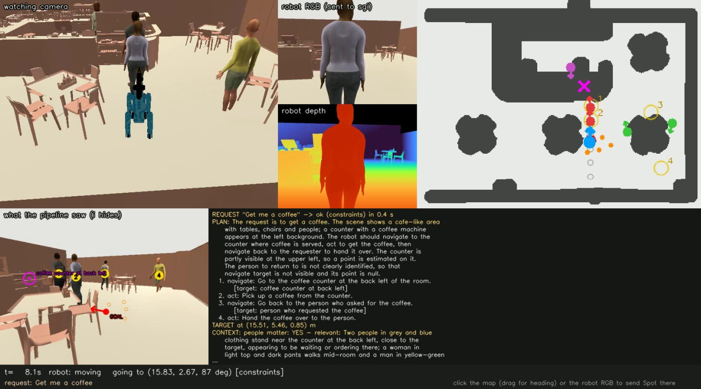

*The window. On the left, a camera follows Spot. Next are Spot's own RGB and depth, which are what the pipeline sees. Then comes a map with the people (red for queueing, green for walking, purple for standing still, such as a barista or performers) and Spot (blue) with its path and goal. Below them is the pipeline's output for the last request. It shows the image with the target, the numbered people it found and the goal, and beside it the reasoning of each step.*

## Quick start

You need Linux with an NVIDIA GPU, and [Miniconda](https://docs.anaconda.com/miniconda/).

### Step 1: clone the repository

```bash
git clone https://github.com/LWZ19/social-goal-inference.git
cd social-goal-inference
```

### Step 2: download the required models

Three scenes use 3D models made by others. They are free on Sketchfab (CC BY 4.0), but each download needs a free Sketchfab login, so the models are not in this repository. Open each link, press **Download 3D Model**, choose the format given, and save the `.zip` into `~/Downloads` without renaming it:

| Model | Format to choose | Saved as | Used by |
|---|---|---|---|
| [Modern Coffee Shop Interior - Sweet Spot Cafe](https://sketchfab.com/3d-models/modern-coffee-shop-interior-sweet-spot-cafe-0d7900fbf8af442ebac526fe3f5b5394) | glTF | `modern_coffee_shop_interior_-_sweet_spot_cafe.zip` | the Sweet Spot café |
| [Simple Concert Stage](https://sketchfab.com/3d-models/simple-concert-stage-d5c7733d06d24947bf60b3a0fe203f69) | Original format | `simple-concert-stage.zip` | the concert |
| [barigate 8 met besi hitam](https://sketchfab.com/3d-models/barigate-8-met-besi-hitam-07ba7df39b3a4947bb5f0910b9fbc530) | Original format | `barigate-8-met-besi-hitam.zip` | the concert |

You can skip this step. The kitchen flat, the simple café and the room work without it.

### Step 3: set up and create the scenes

```bash
sim/setup.sh                 # or: sim/setup.sh /path/to/folder/with/the/zips
```

This one command:

1. creates the conda environments `sgi` (the pipeline), `sgi-habitat` (the simulator) and `sgi-tools` (model conversion),
2. makes the pipeline's generated test scenes, and downloads Habitat's people, the Spot robot and the kitchen flat (about 430 MB together),
3. creates the scenes made in code, which are the simple café, the room, the concert ground, and the coffee cart, plant and water cooler,
4. creates the scenes from your downloads, unpacking and painting the Sweet Spot café, converting the concert stage and putting its textures on, and bringing in the barricade,
5. makes an empty `.env` for your model key.

It takes about ten minutes the first time. Everything it makes goes under `data/`, which git ignores (see [What is in git](#what-is-in-git)). It lists any download it did not find, with its link. You can run it again at any time, for example after adding a download, and it skips what is already done.

### Step 4: add a model key

Open `.env` and fill in one key, on one line, with no spaces or quotes:

```bash
ANTHROPIC_API_KEY=sk-ant-...
```

The example runs on this page used Claude Haiku (Anthropic). Gemini, OpenAI or SoCLaaS also work, each with its own line in `.env`.

### Step 5: run

```bash
sim/demo.sh --model claude_haiku55 -- --scenario sim/scenarios/sweet_spot_line2.yaml
```

A window opens. Type `Get me a coffee` in the terminal and watch Spot work out where to go. For the concert, try `concert_sparse.yaml` or `concert_crowded.yaml` and ask *"Where should I go to get a good close-up view of the concert?"*. Every scenario is in [`scenarios/`](scenarios/).

## How it works

Two programs run side by side and talk over HTTP on the local machine. Habitat needs Python 3.9 and the pipeline Python 3.12, so each has its own conda environment.

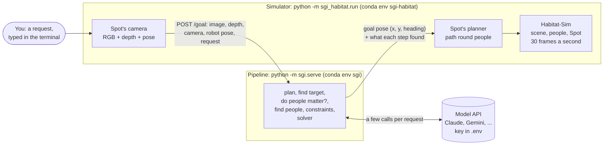

What happens for one request:

1. **The simulator runs the scene.** Habitat-Sim renders the room, Habitat 3.0's humanoids walk, queue or stand, and Spot stands still. The scene runs in real time.
2. **You type a request,** such as "Get me a coffee". The simulator takes Spot's camera image, its depth image, the camera's pose and Spot's pose at that moment, and sends them with the request to the pipeline (`POST /goal`). The people keep moving while it waits.
3. **The pipeline decides the goal.** This is the social goal inference method in `src/sgi`. It calls a vision-language model through its API (Claude, Gemini, OpenAI or SoCLaaS, with the key in `.env`). The model plans the request and finds the target, judges whether the people there matter, finds and numbers the people, and states constraints such as "come after persons 1 and 2". A geometric solver then turns the constraints into a goal pose. This takes about four model calls, 5 to 15 seconds with Claude Haiku. Answers are cached, so the same request on the same image costs nothing the second time.
4. **The answer comes back.** It holds the goal pose and everything each step found (the plan, the people, the constraints, the reasoning), which the window draws.
5. **Spot walks there.** It plans a path on its own navmesh, kept clear of furniture, and plans it again twice a second round the people near it. It calls the model again while it walks only with `--requery`, which checks the goal every few seconds.

The model sees only what Spot's camera sees. It gets no map and no positions from the simulator, so where Spot stops follows from that one image.

## Environments

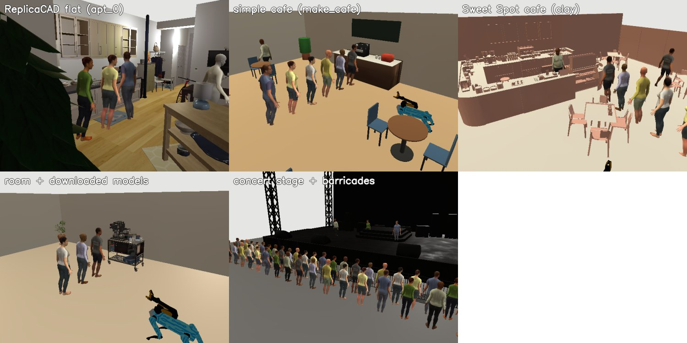

| Environment | What it is |
|---|---|
| **Kitchen flat** | ReplicaCAD's apartment, from the Habitat datasets, with a queue at the kitchen counter and people walking about. |
| **Simple café** | A café built in code, with a coffee counter, a machine and menu board, and four tables. |
| **Sweet Spot café** | A downloaded coffee-shop interior, with a U-shaped counter with machines, a pastry case, tables, and a barista behind the counter. |
| **Room with downloaded models** | An empty room furnished with models from the internet, including a coffee cart, plants and a water cooler. |
| **Concert** | An open ground with a concert stage, barricades in front of it, and performers on the stage. |

People are animated Habitat 3.0 humanoids that walk, queue, stand still or wait their turn. Any scene or object downloaded as `.glb`, `.gltf`, `.obj` or `.fbx` can be brought in. The Sweet Spot café came without colours and was given the two tones of Sketchfab's clay view:

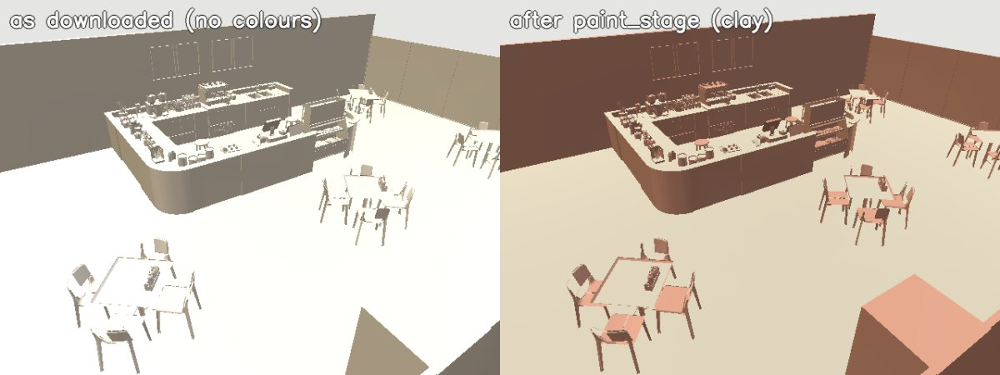

## The cases

There are two kinds of place, each with one request:

- **Café: "Get me a coffee".** In each café, the line at the counter is empty, two people long or six people long. Spot starts in the same place in all three, where it sees the counter and everyone in the line, and two people walk about in the background. The right place is the counter itself when nobody waits, and the end of the line otherwise.
- **Concert: "Where should I go to get a good close-up view of the concert?"** The front of the barricades is either packed (a full front row and a second row behind it) or sparse (a few people scattered). The right place is behind the crowd when it is packed, and a free stretch of barricade when it is not.

The pipeline ran on Claude Haiku 5.5, the smallest and fastest model. Each case was run once.

| Case | People waiting | Where Spot went | | Video |
|---|---|---|---|---|
| Simple café, line 0 | none | to the counter, 1.05 m in front of it, facing it | ✅ | [video](videos/cafe_line0.mp4) |
| Simple café, line 2 | 2 | behind the line, but off to its side | ◐ | [video](videos/cafe_line2.mp4) |
| Simple café, line 6 | 6 | well off to the side: two people walking about were counted as part of the line | ❌ | [video](videos/cafe_line6.mp4) |
| Sweet Spot, line 0 | none | to the counter, 1.14 m in front of it, facing it | ✅ | [video](videos/sweet_spot_line0.mp4) |
| Sweet Spot, line 2 | 2 | 1.06 m behind the last person, in line, facing the counter | ✅ | [video](videos/sweet_spot_line2.mp4) |
| Sweet Spot, line 6 | 6 | cut in beside the end of the line | ❌ | [video](videos/sweet_spot_line6.mp4) |
| Concert, sparse | a few at the front | to a free gap at the barricade, facing the stage | ✅ | [video](videos/concert_sparse.mp4) |
| Concert, crowded | full front row | stayed behind the crowd, but 6 m back and turned partly away from the stage | ◐ | [video](videos/concert_crowded.mp4) |

The model gets the empty cases and the short lines right, and tells a sparse front from a packed one. Its errors are with long lines (mixing in people who walk past, or cutting in) and with how close to stand behind a crowd.

Each picture below shows, from left to right, the image the model was given with its marks on it (the target ringed, the people it found numbered, its goal in red), the scene when Spot stopped, and the map.

### Café: "Get me a coffee"

**Simple café, nobody in line.** The model sees nobody waiting and sends Spot straight to the counter.
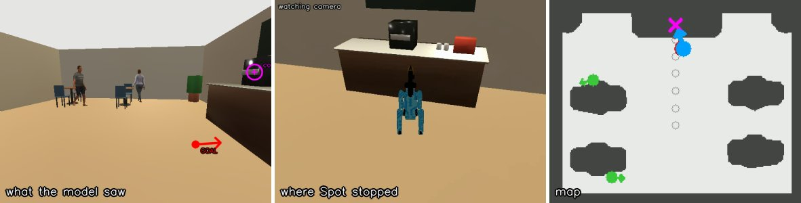

**Simple café, two in line.** Spot ends up behind the two, but to the side of the line.
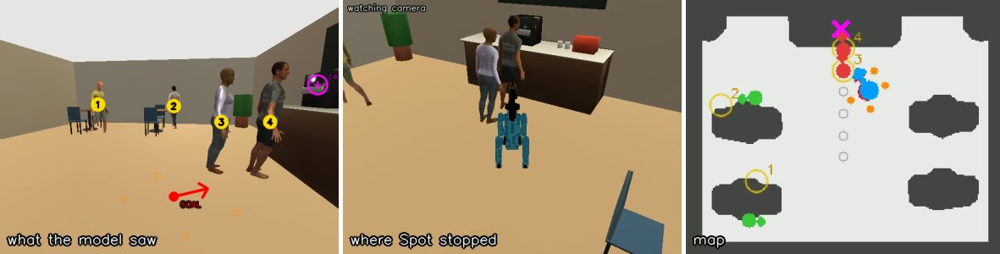

**Simple café, six in line.** The two walkers were taken for part of the line, which pulled the goal off to the side.
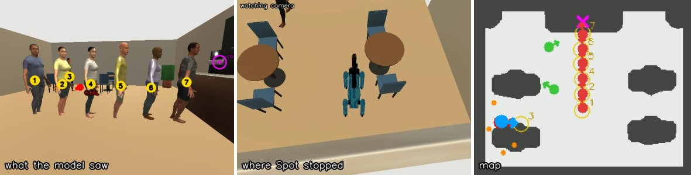

**Sweet Spot café, nobody in line.** The barista stands behind the counter. Nobody waits, so Spot goes to the counter.
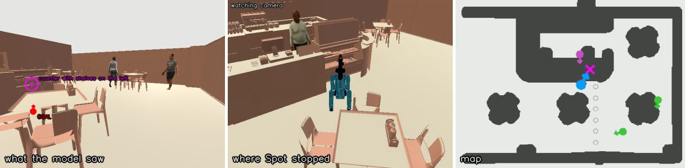

**Sweet Spot café, two in line.** Spot joins the end of the line, 1.06 m behind the last person, facing the counter.
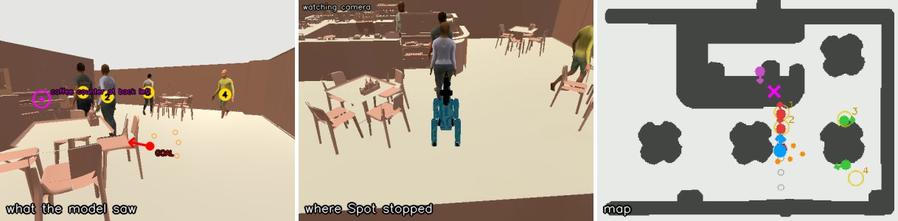

**Sweet Spot café, six in line.** Spot stops beside the end of the line instead of behind it.
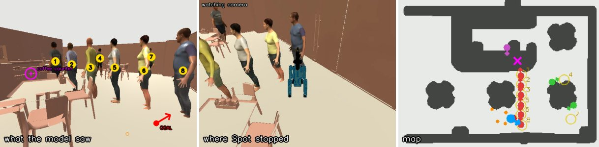

### Concert: "Where should I go to get a good close-up view of the concert?"

**Sparse front.** The model names "the metal barrier fence in front of the stage" and sends Spot to an empty stretch of it, between people already there.
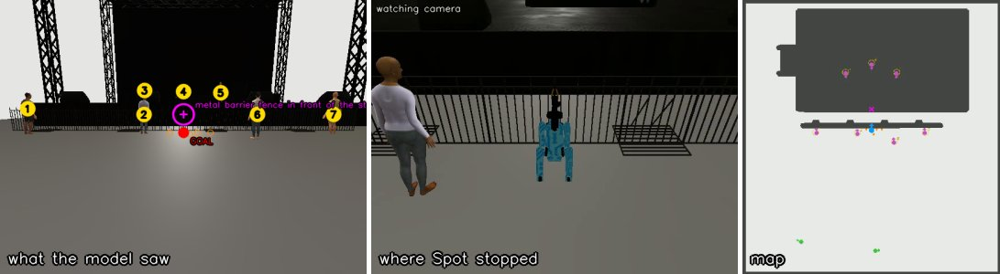

**Crowded front.** The model sees "a dense row of spectators" and keeps Spot behind them. Spot stops well back from the crowd.
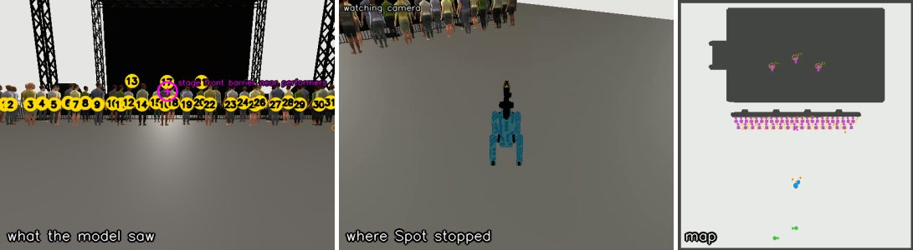

## Moving among people

In this demo the goal is decided once, from one view. Spot plans its own way there and plans it again twice a second round the people near it. So it walks round a line or someone passing instead of stopping for them. It keeps a margin from furniture. With `--requery`, the pipeline is asked again every few seconds while Spot walks, in case the people have moved since the request.

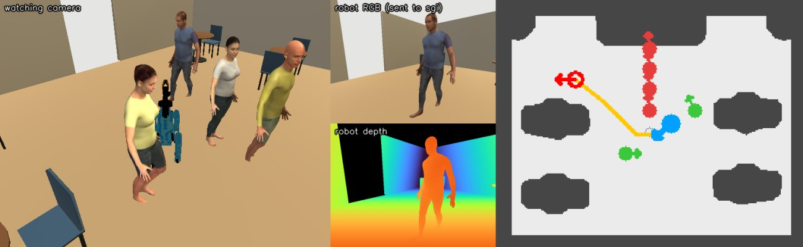

In the moving-line experiments, the robot asks the VLM once, tracks the people it named, and solves for its spot again every half second with no new VLM call (`POST /resolve`, `src/sgi/resolve.py`). They run through `sgi_habitat.experiment` and `sgi_habitat.experiment_oracle`, launched by `results/moving-lines/design-and-scoring/run_moving.py`, and are scored as in [`SCORING_STRICT.md`](../results/moving-lines/design-and-scoring/SCORING_STRICT.md).

## Each step by hand

`sim/setup.sh` (Quick start, step 3) does all of this for you. These are the commands it runs, one by one, for running or changing a step by hand. Everything runs from the repository root, on Linux with an NVIDIA GPU (tested on an 8 GB GPU). Downloads go under `data/`, which git ignores.

### 1. Environments

```bash
conda env create -f envs/sgi.yml              # the pipeline (Python 3.12)
conda env create -f envs/sgi-habitat.yml      # the simulator: Habitat-Sim 0.3.3, habitat-lab 0.3.3, this folder (Python 3.9)
conda env create -f envs/sgi-tools.yml        # only for converting .fbx downloads (Assimp)
```

### 2. Habitat's data

The humanoids, Spot and the ReplicaCAD flat, about 370 MB:

```bash
conda run -n sgi-habitat python -m habitat_sim.utils.datasets_download \
    --uids habitat_humanoids hab_spot_arm replica_cad_dataset --data-path data/habitat --no-replace
```

### 3. A model key

```bash
cp .env.example .env        # then fill in one key, with no spaces or quotes: ANTHROPIC_API_KEY=sk-ant-...
```

The cases above used `claude_haiku55` (Anthropic). `gemini_fast`, `openai_fast` and the SoCLaaS entries work the same way with their own keys. `mock` needs no key, and its answers carry no meaning.

### 4. The scenes

Run these in the `sgi-habitat` environment. The simple café, the room and the coffee cart need no manual download:

```bash
python -m sgi_habitat.make_cafe                                        # data/habitat/stages/cafe.glb
python -m sgi_habitat.make_room                                        # data/habitat/stages/room.glb
python -m sgi_habitat.fetch_models coffee_brewer plant_tall cooler_water
```

The Sweet Spot café is a Sketchfab download ([Modern Coffee Shop Interior - Sweet Spot Cafe](https://sketchfab.com/3d-models/modern-coffee-shop-interior-sweet-spot-cafe-0d7900fbf8af442ebac526fe3f5b5394), glTF format), unpacked and painted:

```bash
mkdir -p data/habitat/downloads/sweet_spot_cafe
unzip ~/Downloads/modern_coffee_shop_interior_-_sweet_spot_cafe.zip -d data/habitat/downloads/sweet_spot_cafe
python -m sgi_habitat.paint_stage data/habitat/downloads/sweet_spot_cafe/scene.gltf data/habitat/stages/sweet_spot_cafe.glb \
    --floor-y 0.15 --region 7.5 21.0 -0.3 9.3 --counter 11.0 16.7 4.9 8.85
```

The concert is an open ground, a stage and a barricade, both from Sketchfab. The stage is [Simple Concert Stage](https://sketchfab.com/3d-models/simple-concert-stage-d5c7733d06d24947bf60b3a0fe203f69) ("Original format", an `.fbx` with its textures). The barricade is [barigate 8 met besi hitam](https://sketchfab.com/3d-models/barigate-8-met-besi-hitam-07ba7df39b3a4947bb5f0910b9fbc530) ("Original format", an `.obj`).

```bash
python -m sgi_habitat.make_room --width 30 --depth 32 --no-walls --floor-rgb 92 92 96 --out data/habitat/stages/concert_ground.glb

D=data/habitat/downloads
mkdir -p $D/simple-concert-stage $D/barigate-8-met-besi-hitam
unzip ~/Downloads/simple-concert-stage.zip -d $D/simple-concert-stage
unzip $D/simple-concert-stage/source/stageSF.zip -d $D/simple-concert-stage/source/stageSF
unzip ~/Downloads/barigate-8-met-besi-hitam.zip -d $D/barigate-8-met-besi-hitam
unzip "$D/barigate-8-met-besi-hitam/source/barigate 8 met besi hitam.zip" -d $D/barigate-8-met-besi-hitam/source/model

S=$D/simple-concert-stage/source/stageSF
conda run -n sgi-tools python sim/fbx_to_glb.py $S/stage-final.fbx $S/stage-final.glb
python -m sgi_habitat.texture_model $S/stage-final.glb data/habitat/objects/concert_stage/concert_stage.glb \
    --base $S/stage-main_None_BaseColor.png --roughness $S/stage-main_None_Roughness.png \
    --metallic $S/stage-main_None_Metallic.png --normal $S/stage-main_None_Normal.png
python -m sgi_habitat.import_model "$D/barigate-8-met-besi-hitam/source/model/barigate 8 met besi hitam.obj" --name barricade
```

### 5. Run it

One script starts the pipeline (env `sgi`) and the simulator (env `sgi-habitat`) together, and stops both when the window closes:

```bash
sim/demo.sh --model claude_haiku55 -- --scenario sim/scenarios/sweet_spot_line2.yaml
```

Type a request in the terminal and press Enter. In the window, a click on the map or on Spot's view sends Spot there directly. `i` shows or hides the reasoning, `c` cancels the goal, `p` pauses and `q` quits. Every request saves the image sent, the answer and the reasoning under `runs/habitat/`.

### 6. The eight cases and their videos

```bash
for sc in cafe_line0 cafe_line2 cafe_line6 sweet_spot_line0 sweet_spot_line2 sweet_spot_line6 concert_sparse concert_crowded; do
  case $sc in
    concert_*) req="Where should I go to get a good close-up view of the concert?" ;;
    *)         req="Get me a coffee" ;;
  esac
  sim/demo.sh --model claude_haiku55 -- --scenario sim/scenarios/$sc.yaml --headless \
      --request "$req" --request-at 2 --exit-on-arrival --linger 4 --seconds 150 --record runs/habitat/videos/$sc.mp4
done
```

Each run prints where Spot stopped, measured against the true scene ("1.06 m behind the last of 2, 0.03 m off the line"). The table above comes from these lines. Model answers vary from run to run, so a new run can differ from the one shown here.

[`docs/habitat.md`](../docs/habitat.md) gives every option, the scenario format, the planner, the frames and the known limits.

## What is in git

Git holds only code, scenario files, docs, and the pictures and videos of this page, about 5.5 MB. `sim/setup.sh` makes everything else on each machine, and `.gitignore` excludes it:

| Not in git | About | What it is |
|---|---|---|
| `.env` | | your model API keys. Never commit this file (`.env.example` is the template). |
| `data/habitat/` | 570 MB | Habitat's people, Spot and kitchen flat, the unpacked Sketchfab downloads, the built scenes |
| `data/placeholder/` | 60 MB | the pipeline's generated test scenes |
| `runs/` | grows | what every run and request leaves behind: images, answers, recordings |
| `.cache/` | small | the pipeline's cache of model answers |

## Credits

- Habitat-Sim and habitat-lab, the ReplicaCAD apartment, the Habitat 3.0 humanoids and the Spot model: Meta AI, each under its own licence (see `data/habitat/versioned_data/` after the download).
- "Modern Coffee Shop Interior - Sweet Spot Cafe" by [ahmadmughal2023](https://sketchfab.com/ahmadmughal2023), from [Sketchfab](https://sketchfab.com/3d-models/modern-coffee-shop-interior-sweet-spot-cafe-0d7900fbf8af442ebac526fe3f5b5394), under [CC BY 4.0](http://creativecommons.org/licenses/by/4.0/). The colours are ours.
- The coffee cart, potted plant and water cooler: from the repository's asset manifest (`assets/realistic/manifest/models.json`), which gives each one's licence.
- "Simple Concert Stage" by [gluttonia](https://sketchfab.com/gluttonia), from [Sketchfab](https://sketchfab.com/3d-models/simple-concert-stage-d5c7733d06d24947bf60b3a0fe203f69), under [CC BY 4.0](http://creativecommons.org/licenses/by/4.0/). Converted to glTF and its textures re-attached by us.
- "barigate 8 met besi hitam" by [eventdesignws](https://sketchfab.com/eventdesignws), from [Sketchfab](https://sketchfab.com/3d-models/barigate-8-met-besi-hitam-07ba7df39b3a4947bb5f0910b9fbc530), under [CC BY 4.0](http://creativecommons.org/licenses/by/4.0/).
- None of the three Sketchfab models is in this repository. Each is downloaded from its page (Quick start). Images of them shared elsewhere have to carry the credit above.
